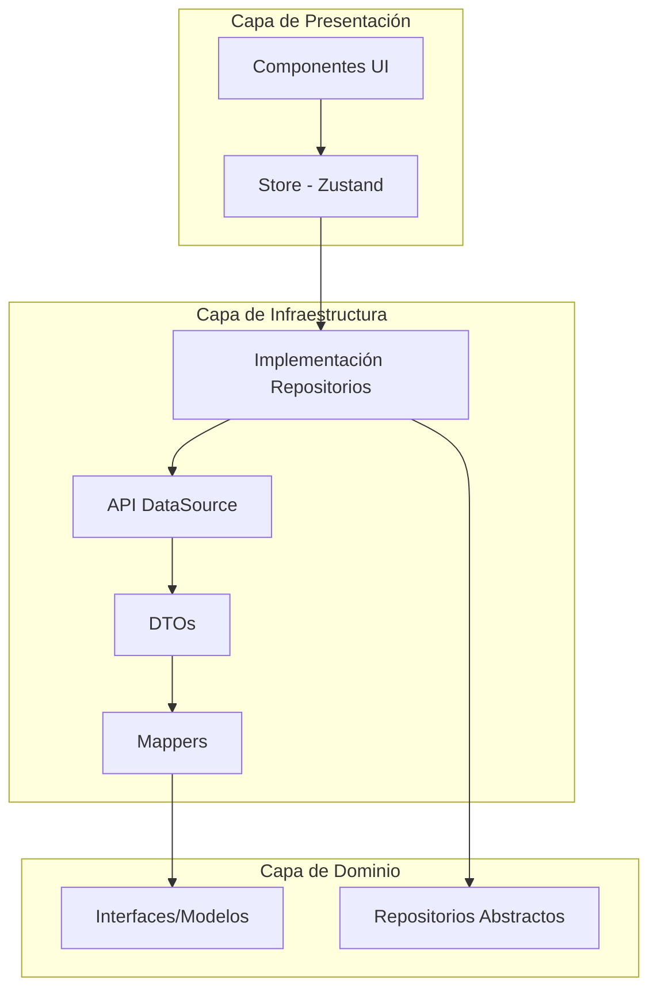
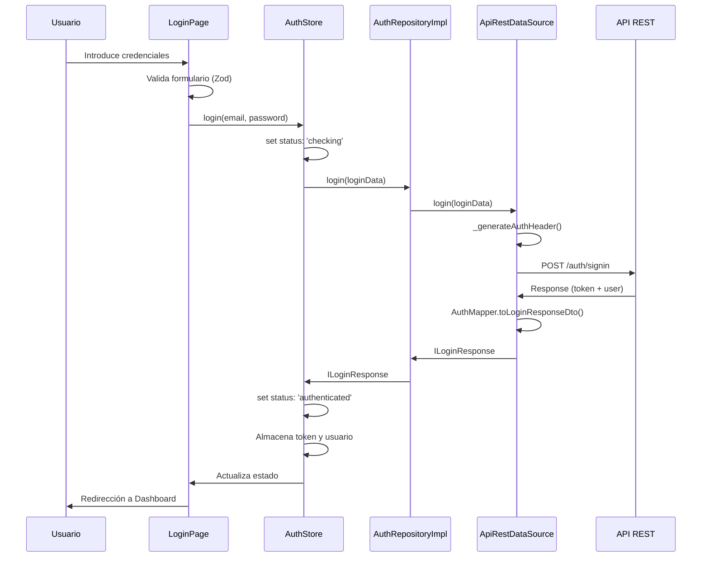
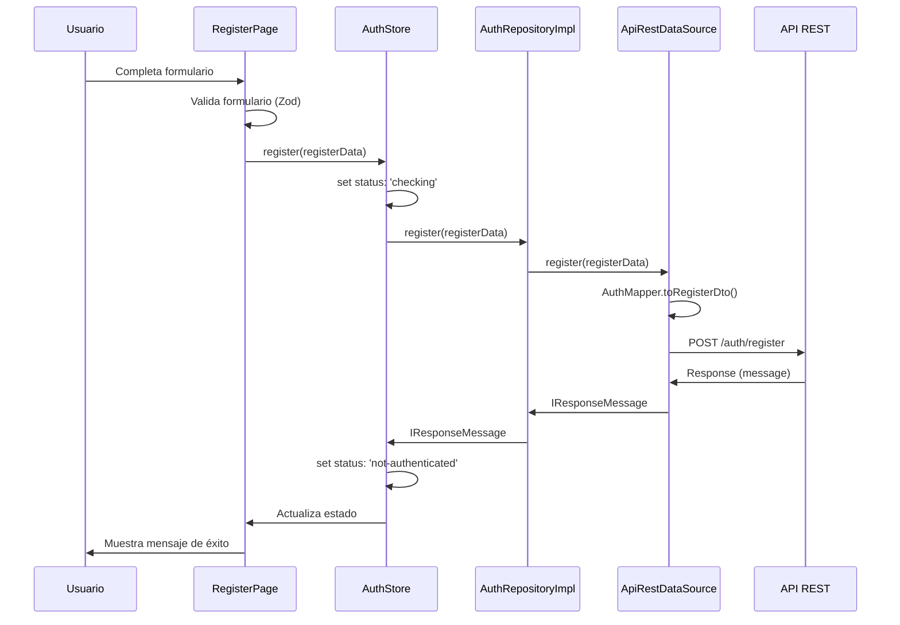
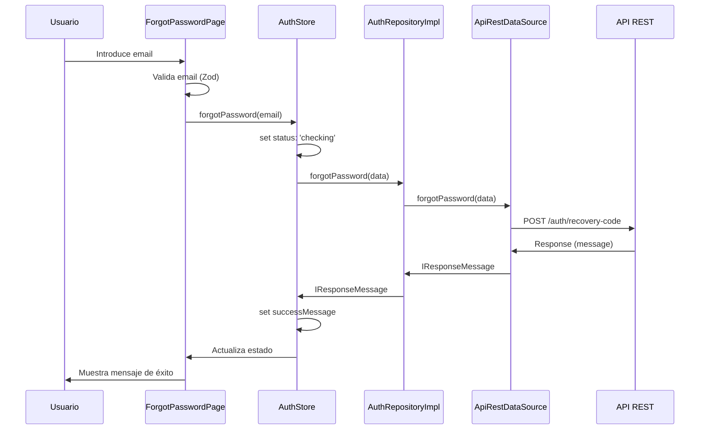
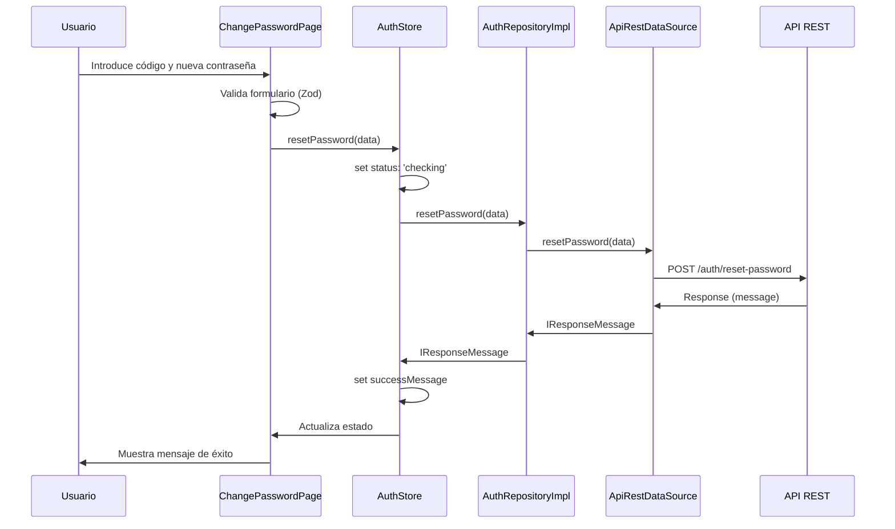
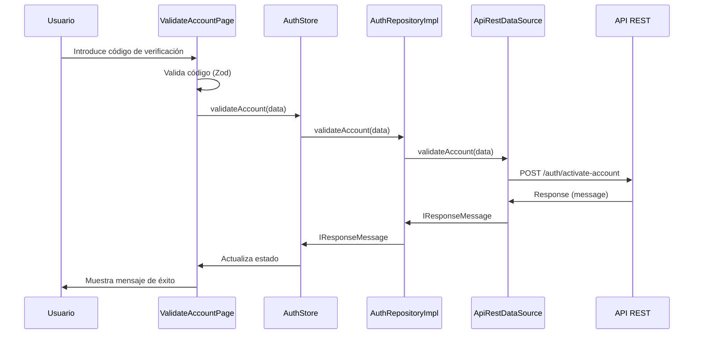
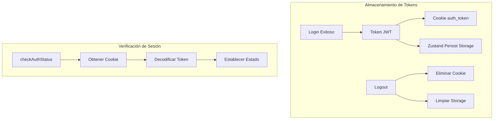
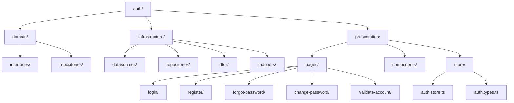
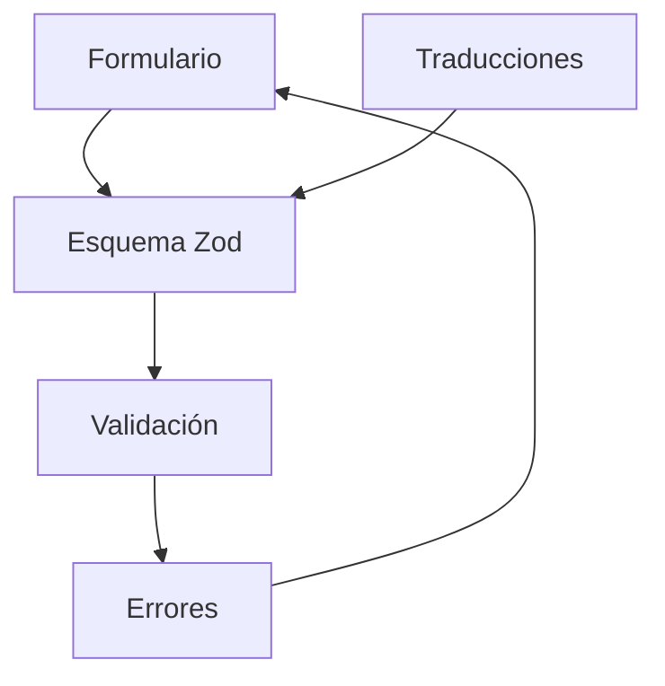
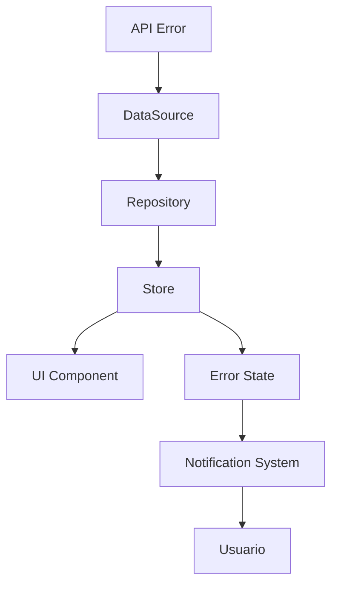

# Documentación del Flujo de Autenticación

Este documento describe la implementación del flujo de autenticación en TuFirma Backoffice, siguiendo los principios de Clean Architecture y Domain-Driven Design (DDD).

## Arquitectura General

La implementación sigue una arquitectura de tres capas:

## Flujo de Login

El siguiente diagrama muestra el flujo completo del proceso de login:

## Flujo de Registro

## Flujo de Recuperación de Contraseña

## Flujo de Cambio de Contraseña

## Flujo de Validación de Cuenta

## Manejo de Tokens y Sesión

## Estructura de Archivos

## Validación de Formularios

La validación de formularios utiliza Zod con soporte para traducciones:

## Manejo de Errores

## Mejoras Futuras

- Implementar casos de uso (Use Cases) específicos
- Añadir tests unitarios para cada capa
- Implementar un sistema de manejo de errores más específico
- Considerar un sistema de inyección de dependencias
